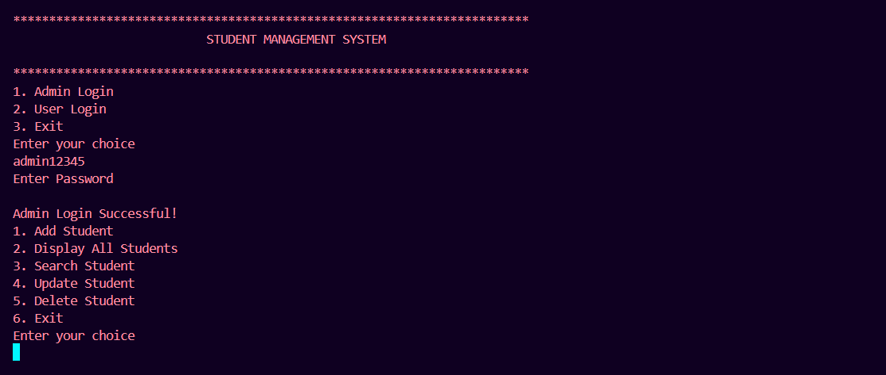
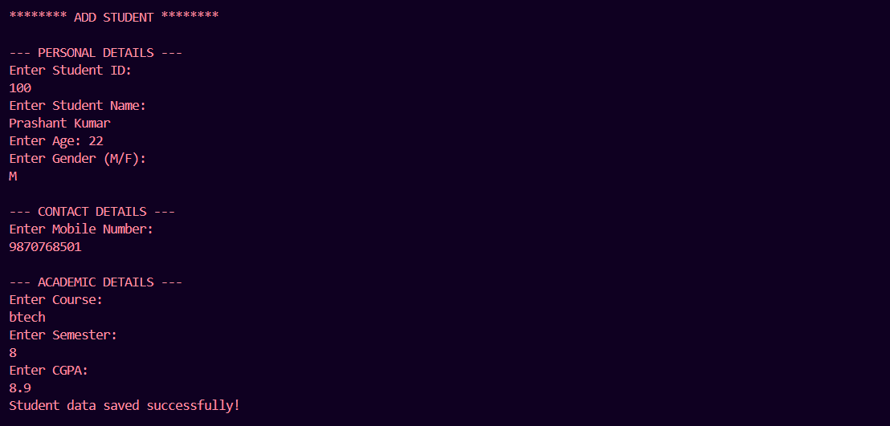
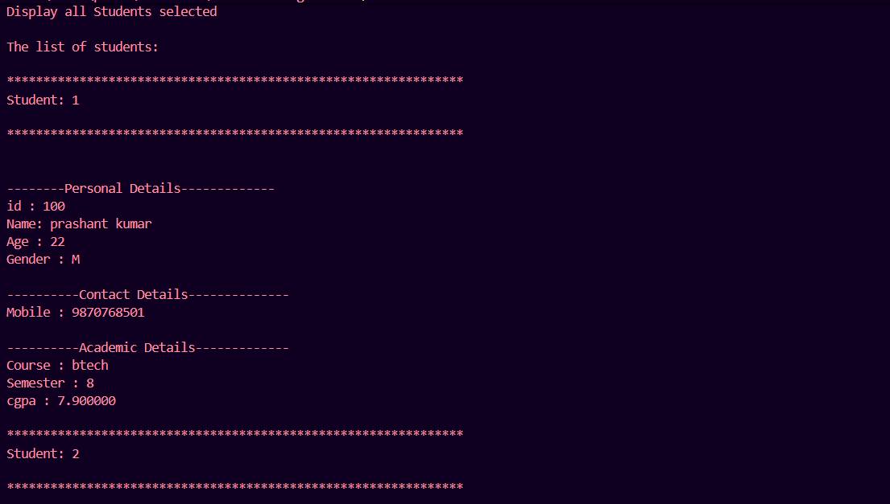
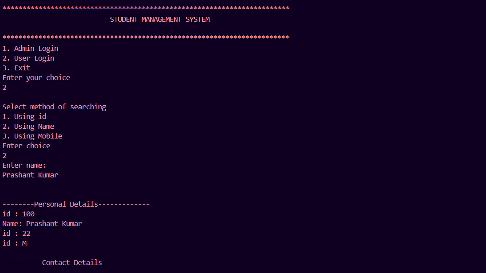

# Student Management System

A console-based Student Management System developed in C. This project helps manage student records with file handling and dynamic memory allocation.

## Features

- Add new student records
- Display all students
- Search students by ID, name, or mobile number
- Update student information
- Delete student records
- Input validation
- Duplicate ID prevention
- Admin and User menus
- File handling for persistent data storage

## Technologies Used

- C Programming
- Structures
- Pointers
- Dynamic Memory Allocation (`malloc`, `realloc`, `free`)
- File Handling
- Git & GitHub

## Data Storage

Student records are stored in a binary file named `students.dat`, allowing data to remain available after the program is closed.

## How to Run

1. Clone this repository:
   ```bash
   git clone https://github.com/prashant-chauhan449/Student-Management-System.git
   ```

2. Open the project folder.

3. Compile the source files:
   ```bash
   gcc main.c student.c -o student_management
   ```

4. Run the program:
   ```bash
   ./student_management
   ```

   On Windows:
   ```bash
   student_management.exe
   ```

## Project Structure

```text
Student-Management-System/
│
├── main.c
├── student.c
├── student.h
├── README.md
└── .gitignore
```

## Author

**Prashant Chauhan**

GitHub: [prashant-chauhan449](https://github.com/prashant-chauhan449)
## Screenshots

### Main Menu


### Admin - Add Student


### Display Students


### User Login

